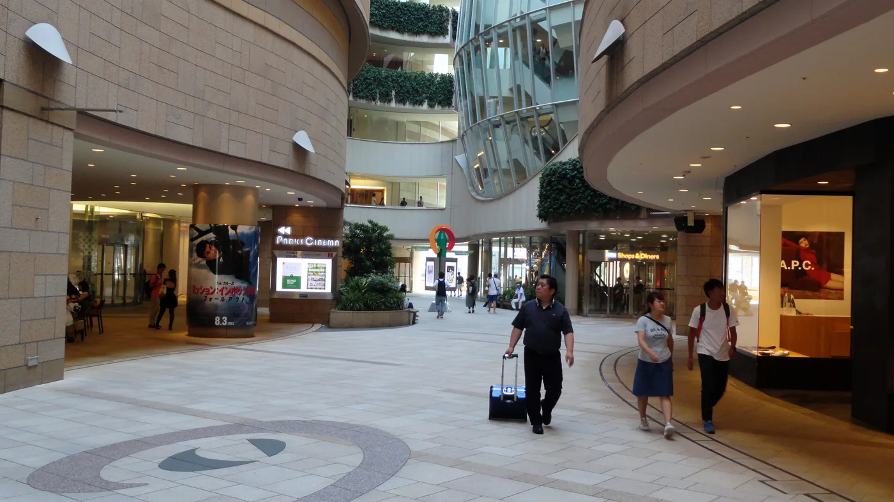
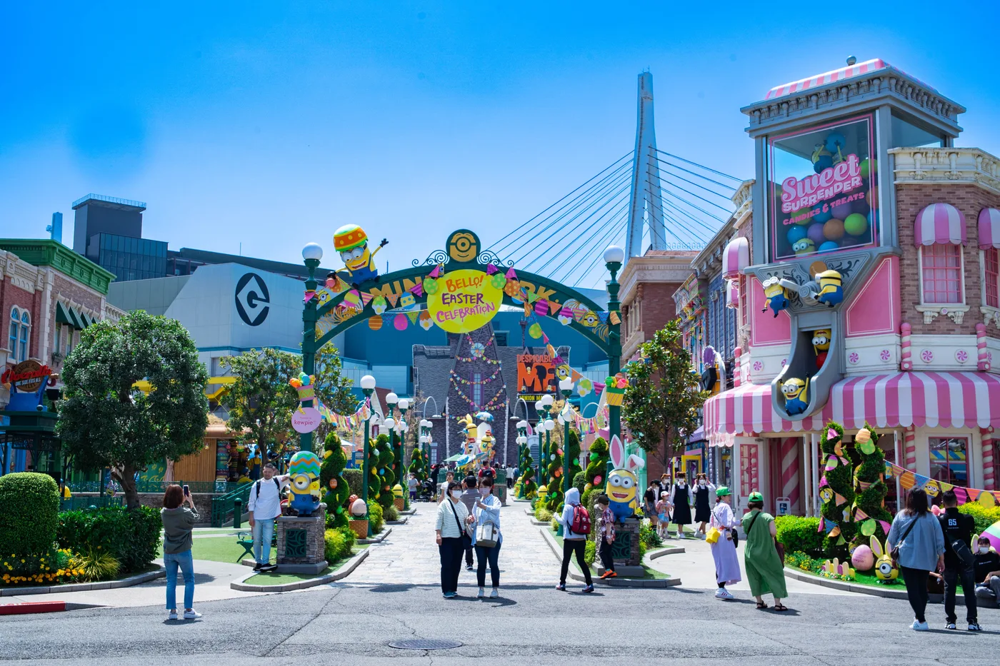
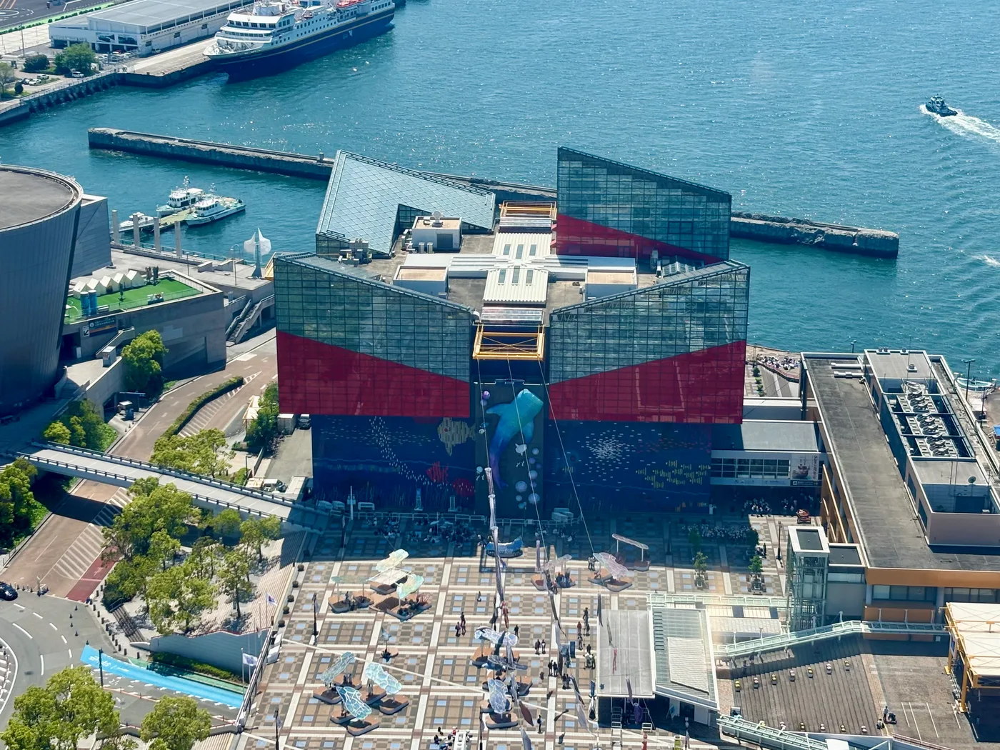
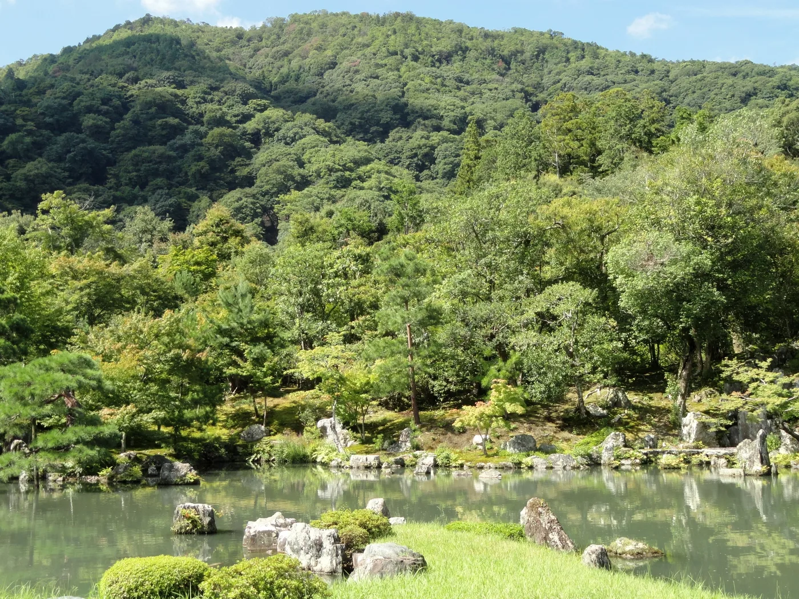

> 研究核验日期：2026 年 11 月 14 日。这是一份四天三晚、两位成人携低龄幼儿的行程设计，不是已经完成的旅行游记，也不是已预订产品。具体出发城市、日期、预算尚未锁定；本文不公开家庭成员身份、儿童生日或未来住宿日期。
>
> **先决定是否出行，再研究怎么玩。** 本轮仍可读取外交部 2026 年 3 月 26 日“近期避免前往日本”提醒，尚未取得已撤销该提醒的证据。因此当前建议是暂缓不可退订支出，把这篇作为备选规划；出发决策前再次核对官方提醒、航班变化和保险除外责任。能买到机票，不代表安全风险已经解除。[外交部原文](https://www.mfa.gov.cn/wjbzwfwpt/kzx/aqtx/zwqw/202603/t20260326_11881693.html)

## 先说结论：大阪住三晚，环球影城一天，京都是替换项

如果只有四天，我会把全程放在大阪同一家酒店，给环球影城一个完整白天，另一个完整白天留给大阪散步或海游馆。京都可以去，但应当**替换大阪的完整游玩日，而不是额外塞进去**。不安排东京、奈良、京都、大阪轮流住，也不为了“都到了”临时追加景点。

这里的四天不是四个完整游玩日。抵达、入境、提取行李与推车、找电梯、到酒店、安顿孩子，都属于行程。返程日同样不能按普通城市游玩日计算。

最重要的取舍有三个：

1. 大人的愿望不是次要需求。环球影城值得保留，但把成功标准定为“大人完成最想体验的一两个项目，一家人舒服地玩过”，而不是刷遍热门设施。
2. 一岁孩子不需要景点数量。看鱼、看车、观察陌生街道、在适合的空间活动，也能构成不错的一天。能否吃饭、换尿布、睡觉，比有没有拍到网红机位更重要。
3. 酒店不是只在晚上用的地方。合适的床、足够放推车的空间、稳定早餐和方便返回的路线，决定这趟旅行的下限。

## 这份方案参考了多少帖子，哪些没有算进去

截至 2026 年 11 月 14 日的本版阅读台账，研究团队在小红书浏览并去重记录了 **153 个已读取正文的帖子 ID**。经保守分类，其中 **119 篇记载作者自述的日本旅行、实住或旅途中现场体验，且有可辨认的亲历细节**；其余包括攻略整理、品牌推广或推广式内容、一般飞行经验、仅有简短摘要或旅行性质不明确的内容。119 篇不等于 119 个独立家庭，也不意味着每篇都是完整长游记。图片未全部逐张读取，视频未纳入已观看样本统计，评论仅限部分可见内容。样本按低龄、关西与照料问题定向选取，并非随机抽样；年龄、季节和地区不同，并非 119 篇都匹配一岁、冬季、关西、四天，也不代表总体比例。

因此，这不是“看完几百篇完整游记”的宣称。它达到了一百篇以上实地经验正文的范围，但没有达到两百篇完整游记。阅读台账保留帖子 ID、分类和去重记录，以便复核。

小红书最有价值的部分，是发现官方页面不会告诉你的摩擦：推车绕电梯、宝宝拒绝陌生辅食、婴儿床实际尺寸不合适、午睡被转车打断。它不能替代签证、检疫、航空和游乐设施的正式规定。

几个真正改变方案的反例：

- [16 月龄宝宝住梅田的负面体验](https://www.xiaohongshu.com/explore/6aef0fb2000000001001350c)：住在车站上方也可能找不到适合推车的出口。作者后来补充，住了三天熟悉后交通和购物方便，但仍觉得不适合遛娃。因此结论不是“梅田不能住”，而是必须核验具体出口至酒店的无台阶路线。
- [一岁宝宝酒店实住](https://www.xiaohongshu.com/explore/66e1a3c2000000001e018545)：订房平台和酒店实际婴儿床安排可能不一致。结论是向酒店确认，不是相信任一平台的一个图标。
- [大阪固定住宿、京都往返的经验](https://www.xiaohongshu.com/explore/69a38766000000001d024627)：标题称一岁，正文及评论实际约一岁半、11 月出行，属于接近年龄段而非精确匹配的案例。不换酒店能减少搬运，但京都坡道与楼梯仍会累。固定酒店不等于跨城没有成本。
- [多城市低龄旅行复盘](https://www.xiaohongshu.com/explore/6902e4ac0000000007022cdf)：过满行程会让家长和孩子同时疲惫。本文据此删掉“顺路再去一个”的安排。
- [辅食临时采购失败的经历](https://www.xiaohongshu.com/explore/68f23de70000000005032674)：当地有母婴用品，不代表现场一定买得到宝宝肯吃的那一种。

没有照搬帖子中的枕头围床、谎报睡篮体重、带肉食品成功入境、开封辅食常温放一天等做法。一次没出问题，不是可复制的安全依据。

## 四天三晚主方案

下面是作息模板，不是必须打卡的时间表。按孩子平时一觉或两觉的睡眠窗口前后平移，不假设所有一岁孩子只睡一次午觉；一次活动超时，就删掉下一项，不压缩喂养和睡眠。

| 日期 | 上午 | 午间与午睡 | 下午与晚上 | 当天退出条件 |
|---|---|---|---|---|
| 第一天：到达大阪 | 白天直飞为优先；机场流程预留充分时间 | 到酒店寄存或入住，先解决吃饭和换尿布 | 只在酒店附近散步、吃饭、补给；不预约付费景点 | 延误、孩子疲倦就直接休息 |
| 第二天：环球影城 | 酒店早餐，出门前喂养换尿布；按当天营业时间入园 | 园内吃饭、护理和休息，不安排出园回酒店再入园 | 大人轮流体验，孩子看街景、角色和氛围；下午可提前离园 | 连续烦躁、无法午睡、风雨明显或家长体力下降 |
| 第三天：大阪轻松日 | 晴天选大阪城公园外围或难波周边；雨天选海游馆 | 以酒店午睡或安静休息为核心 | 市区基地可在同一片区短走用餐；园旁基地若回酒店午睡，之后不再折返难波 | 上午已经累，就取消下午 |
| 第四天：回程 | 早餐、整理、退房；只有时间充足才附近短走 | 去机场，给电梯、厕所、安检和喂养留余量 | 回家 | 不安排跨区购物和最后一个景点 |

**晴雨换日规则：** 第二天和第三天可交换，但前提是门票、酒店和预约规则允许；不能假设 USJ 票可以随意改日。出发前看近期预报，前一晚和当天早晨再更新。远期十二月天气不能精确到某一天。

### 第一天：把入境日当成安顿日

理想抵达时间是中午至下午较早时段。落地后不要立刻开始“关西第一站”。按机场实际到达流线办理手续，并利用途中可用护理设施就近照料；推车领取地点和时机依航司与机场安排，不能预设在入境前取回。机场至酒店的交通选择以实际酒店为准：直达列车并不总比机场巴士轻松，巴士也不保证不用走路或不用折叠推车。

晚上如果住难波，围绕酒店与高岛屋附近吃饭就够了。道顿堀可以短暂感受大阪的热闹，但拥挤、噪声和小餐馆空间都不适合把一岁孩子的晚饭寄托在那里。晚餐优先可坐下、可放推车、有熟悉食物的地方。

*难波公园示意图。Fabio Achilli，2018 年 8 月，[原图](https://commons.wikimedia.org/wiki/File:Namba_Parks,_Namba_Station,_Minami_(43289319575).jpg)，[CC BY 2.0](https://creativecommons.org/licenses/by/2.0/)。这是历史夏季照片，不代表十二月植被、天气或当前施工情况。*

### 第二天：环球影城的目标是全家都觉得值得

*Dick Thomas Johnson，2022 年 4 月 25 日，[原图](https://commons.wikimedia.org/wiki/File:Universal_Studios_Japan_2022-04-25.jpg)，[CC BY 2.0](https://creativecommons.org/licenses/by/2.0/)。并非当季圣诞活动实拍。*

**更多实景参考：[USJ 入口实拍（2026 年 10 月）](https://commons.wikimedia.org/wiki/File:USJ_Entrance_2026.jpg)**。Sakai Yayoi，CC0。点击来源页查看原图；此处未嵌入，不代表十二月活动布置。

#### 不把一岁宝宝当成“小号儿童游客”

三岁及以下通常无需购买入园门票，但免费入园不等于可以乘坐游乐设施。园方按身高、独立坐姿及具体健康条件判断。当前耀西冒险官网最低身高为 92 厘米，不能沿用旧资料里的 86 厘米；其他项目也须逐项核验。本文不把任何机动项目写成“一岁必玩”。[耀西官方限制](https://www.usj.co.jp/web/en/us/service-guide/safe/yoshis-adventure) · [官方身高规则](https://www.usj.co.jp/web/ja/jp/attractions/requirements/height-restriction)

更适合共同体验的内容，是角色与街景、短时看表演、适宜天气下慢慢走。音量大、人群密集或孩子表现不适就离开，不以“票贵”作为坚持的理由。

#### 大人如何玩到自己想玩的

出发前两位成人各选一个最想玩的项目，列出“必须体验”和“有余力再说”。符合条件的项目可使用 Child Switch，由成人轮流乘坐；但它不是免排队，也不是托儿服务，另一位成人始终负责孩子。是否购买快速通行证，要对照具体日期、包含项目、时段和双方愿望决定，不能凭帖子推断“雨天不用买”。[Child Switch 官方说明](https://www.usj.co.jp/web/ja/jp/attractions/how-to-fun/child-switch)

超级任天堂世界的区域入场安排、整理券和快速通行证内容需要单独查看；普通入园票不保证随时进入每个热门区域。不要为了赶一个区域时段，跳过孩子午睡和正餐。

#### 一日节奏

- 出发前：吃早餐、换尿布、检查当日随身包。把不能缺少的物品带进园，不留在酒店等着中途回去取。
- 入园后：先确认最近的家庭服务设施和当天开放状况，再开始游玩。
- 上午：一位成人体验核心项目，另一位带孩子附近轻松活动，之后交换。
- 午间：避开餐饮高峰，先照顾孩子吃饭，再安排成人进餐；不让“排了很久”占掉下一次喂养。
- 午睡：安排园内相对安静的休息，遵循平时安全睡眠习惯；如果无法睡或天气太差，就提前结束。
- 下午：只做一项低压力活动或另一个成人项目。早离园不算失败。

**普通 Studio Pass 不允许出园后再进入。** “住园旁，中午回酒店睡两小时再来”不能作为默认方案。如果孩子固定需要床上午睡，默认设计为半日 USJ，午睡前离园回酒店；不能用园内“安静休息”替代必须的睡眠。园旁酒店的价值是入园前和离园后省力，不是自动获得再入园权利。[USJ 儿童服务](https://www.usj.co.jp/web/en/us/service-guide/theme-park-services/children)

#### 尿布、奶与辅食

园内现有 3 处家庭服务设施，地点包括游客服务处、Universal Wonderland 和旧金山区域南侧急救站旁；不同地点设备不完全相同，旧金山区域设施不提供微波炉。非餐厅区域的男女卫生间设有换尿布台；仍按官网和现场地图定位，不要到了急需时才开始搜索。婴儿食品和幼儿零食应按入园规定向工作人员确认，尤其核对包装；不能理解为任何自带食品都可以带入。[日文儿童服务](https://www.usj.co.jp/web/ja/jp/service-guide/children) · [入园物品规定](https://www.usj.co.jp/web/en/us/service-guide/park-entry)

自带熟悉推车更稳妥。园内推车租赁面向 1–48 月龄，当前费用 1,100 日元，数量有限且不接受预约，不应依赖一定租得到。尿布按孩子平时用量加延误余量准备，不能把某篇帖子成功买到应急尿布当库存保证。

一个接近本次结构的经验是[12 月四天三晚、未满两岁家庭](https://www.xiaohongshu.com/explore/69580ceb000000001e0111f8)：为保留爸爸的愿望去了 USJ，孩子主要感受氛围、拍照。[1 月 7 日带一岁半孩子的案例](https://www.xiaohongshu.com/explore/67849f6f000000000100044b)则提到风大、需要室内取暖和成人轮流游玩。这不是刚满一岁必然适应的保证，只支持保留大人愿望同时保护休息。

**旧帖的室内备选不能直接照抄。** 官方停运列表显示 Sesame Street Fun World 自 2026 年 5 月 10 日关闭，Sesame Street 与 Shrek 的 4D 项目自 2026 年 1 月 8 日起无限期关闭；不列入本方案雨天后备。另据同一官方列表，WaterWorld 于 2026 年 11 月 28 日至 12 月 25 日停演，Space Fantasy 停运至 2027 年 1 月 24 日；前者与十二月旅行窗口直接重叠，不能作为确定的表演安排。以上状态仍须按实际出行日再次复核，不能把计划停运结束日视为恢复运营保证。Snoopy Studios 内也要逐项看限制，不能把“室内”当成“婴儿适用”。[USJ 官方停运列表](https://www.usj.co.jp/web/en/us/park-guide/schedule/attraction-closure)

#### 晴、雨、冷风分别怎么改

- 晴天：户外活动和休息交替，仍然保留暖和的室内停留。
- 小雨：雨罩、方便成人操作的雨衣、干衣袋；雨罩保持通风，不能把推车完全密闭。
- 持续雨或大风：减少户外等待，优先护理和休息；设施可能因天气调整，雨天不一定更省心。
- 孩子明显不舒服：结束游玩。票价已经花出去了，不需要再用体力“挣回来”。

### 第三天：大阪轻松日，比“再刷一城”更稳

#### 晴天 A：公园外围加酒店午休

**实景参考：[大阪城公园东外壕秋景](https://commons.wikimedia.org/wiki/File:Osaka_Castle_Park_in_202011_002.jpg)**。Mc681，2020 年 11 月，[CC BY-SA 4.0](https://creativecommons.org/licenses/by-sa/4.0/)。点击查看原图，不是十二月实时景色，也不用于证明路线全程无台阶。

大阪城公园适合大人感受城市、孩子观察环境。但本文推荐的是短距离外围散步，不要求登天守阁，也不要求绕完整个园区。选择靠近交通的出入口，遇碎石、台阶和拥挤路段就缩短路线。天气暖和、孩子状态好，再增加一点步行；冬季不为照片久坐吹风。

#### 雨天 B：海游馆一个主项目就足够

**补充地面视角：[海游馆建筑与广场实拍](https://commons.wikimedia.org/wiki/File:Osaka_Aquarium_Kaiyukan.jpg)**。Tokumeigakarinoaoshima，2019 年，[CC BY-SA 4.0](https://creativecommons.org/licenses/by-sa/4.0/)。来源页可查看原图；与下方外观照相互补充，不代表当前施工或馆内动线。

*海游馆外观示意。Sakai Yayoi，2026 年 5 月，[原图](https://commons.wikimedia.org/wiki/File:Kaiy%C5%ABkan.jpg)，[CC0](https://creativecommons.org/publicdomain/zero/1.0/)。外观照片不证明馆内推车动线。*

水族馆同时有成人和低龄孩子能感受的内容，不要求孩子理解讲解，也不要求全程兴奋。问题在于：从酒店来回的成本、馆内人流、楼层动线与推车安排。不同游记有“寄存推车”和“工作人员协助使用电梯”两种经验，不能据此说所有区域都能随意推车。

[一岁孩子放弃 USJ 选择海游馆的家庭](https://www.xiaohongshu.com/explore/6666fbea000000000e03339d)反馈孩子兴奋，选择寄存推车用背带；[5 岁加 1 岁双孩家庭](https://www.xiaohongshu.com/explore/684981cf000000002200740b)写到员工协助走电梯；而[10 月龄家庭](https://www.xiaohongshu.com/explore/68ecb7c20000000004015099)中途未找到换尿布点，到了出口才处理。既有孩子喜欢的理由，也有照料成本，不能只取“适合亲子”。

出发前向馆方核对当日无台阶路线、推车使用或寄存、护理室位置与预约票规则。到馆前先喂养换尿布，随身带背带作为需要时的备用；不要把背带当成全天抱娃的补救。看完就吃饭休息，不再串联摩天轮、乐高和一整套港区项目。[海游馆官网](https://www.kaiyukan.com/language/eng/)

本轮官网直接读取遇到访问错误，故不承诺具体护理室楼层或所有区域推车可达。相关设施必须临行确认。

## 京都可以加入，但不是四天必选

### 我会在什么情况下选京都

只有在成人确实更想体验京都、孩子前两天状态稳定、天气合适、且愿意把大阪第三天取消时，才使用京都模块。仍住大阪，不增加一晚京都酒店。若京都本身是旅行核心，更好的做法是延长至五到六天，或降低环球影城的优先级，而不是进一步压缩照料时间。

大阪站到京都站的列车时间只是站到站。去大阪站、找电梯、候车、到京都后的接驳，都要加进去。对于推车家庭，地图上的三十分钟不是实际门到门三十分钟。

### 京都晴天替换模块：只选一小片区域

**方案一：京都站—梅小路一带，核验最后一段接驳。** 抵达后先吃饭和护理，再选择一处短活动，下午按状态返程。铁道博物馆可以作为对交通感兴趣的成人主题，但一岁孩子不能使用所有互动设施，且从京都站还需乘 JR 嵯峨野线至梅小路京都西站，官网标注该站步行约 2 分钟，站内电梯和实际门到门时间另算。常规周三及 12 月 30 日至 1 月 1 日等闭馆，具体以馆历为准；不是“宝宝必玩”。[交通](https://www.kyotorailwaymuseum.jp/en/access/) · [开放日历](https://www.kyotorailwaymuseum.jp/en/)

**方案二：四条周边加短段鸭川。** 以百货店作为吃饭和护理锚点，只走易于返回的一段。鸭川不同岸段的坡道、台阶和路面不同，不要沿河走到很远后才找出口。实际路线先查看无台阶入口。

**不作为默认模块：清水寺、二年坂三年坂、伏见稻荷、岚山一日串联。** 它们各自有魅力，但坡道、石板、楼梯、拥挤和城内换乘会叠加。某位家长成功推车到达，不证明全线省力；有些“推车友好”帖子实际上绕过了寺院或仍需短段抬车。

*京都气质示意，并非本方案必到景点。Daderot，2012 年 8 月 22 日，[原图](https://commons.wikimedia.org/wiki/File:Tenryuji_Garden-_DSC05970.JPG)，[CC0](https://creativecommons.org/publicdomain/zero/1.0/)。不能据此期待十二月同样的绿意，也不代表庭园全线适合推车。*

### 京都雨天：不为了京都而跨城

**室内实景参考：[京都铁道博物馆主馆内景](https://commons.wikimedia.org/wiki/File:Main_building_of_the_Kyoto_Railway_Museum.jpg)**。Christophe95，2018 年，[CC BY-SA 4.0](https://creativecommons.org/licenses/by-sa/4.0/)。点击来源页查看原图；照片用来理解展示空间，不保证当前展陈和拥挤程度。

如果尚未出发、持续下雨，就留大阪使用室内模块。京都水族馆或铁道博物馆能作为已经身处京都时的替代，不意味着值得为躲雨多做一次跨城往返。图书、室内亲子设施也可能有预约、年龄或使用规则，未确认前不要写进确定行程。

## 酒店怎么选：先确认床，再比较景观

四天三晚选择同一家。优先级是：适龄且确认有库存的婴儿床、安全摆放空间、无烟房、可到达的电梯路线、早餐与清洁条件，然后才是照片和景观。

| 候选方向 | 适合谁 | 主要好处 | 需要接受的代价与必须核验项 |
|---|---|---|---|
| Universal Port / Universal Port Vita | 环球影城是最重要愿望 | 靠近园区；官方有低龄家庭服务说明 | 市区及京都日增加通勤；婴儿床数量有限，年龄、体重、身高及站立能力需酒店确认；不能保证中午离园再入园 |
| 难波区域酒店，如 Swissotel Nankai Osaka | 更看重机场、市区餐饮与补给 | 难波交通和高岛屋护理设施可作锚点 | 大站仍有电梯与楼层绕行；要核对具体房型、婴儿床、餐费和到站路线 |
| 合适位置的 MIMARU 公寓型酒店 | 更需要空间、简单食物处理 | 房型与厨房配置可能便利 | 各分店位置、婴儿床库存和房型不同；厨房不等于所有器具或消毒设备齐全 |
| 天王寺等实住口碑较好的酒店 | 航班和活动路线恰好匹配 | 某些酒店空间与商场连接良好 | 不能只凭“亲子”标签；酒店与平台婴儿床信息可能冲突 |

这是一份候选类型清单，不是查过指定日期库存后的排名。**我倾向于：USJ 权重很高就先核 Port / Vita；希望整体市区更便利就先核难波。** 这是基于设施和路线的设计判断，并非帖子票数排名。不默认选便宜但需要多次换乘的远处酒店。

Port / Vita 官方说明有面向 0–24 月龄的有限婴儿床服务，需提前预约并确认实际适用条件；Vita 二楼有 24 小时婴儿护理空间，Port 没有公共 baby room，两家不能混同。Park Front 的婴儿床年龄限制为未满一岁，不能直接拿来满足刚满一岁的需求。床围通常也有年龄限制，不能用成人大床加枕头替代合适婴儿床。[Port / Vita 官方 FAQ](https://universalport.orixhotelsandresorts.com/faq/cat?cd=02&facility_cd=universalport-qa&lang=en) · [Park Front 家庭服务](https://parkfront-hotel.com/stay/family_support.html)

### 订房前发给酒店的核验清单

- 两位成人加实际月龄的儿童，所选房型是否允许？儿童、早餐和当地税费是否另收？
- 婴儿床能否书面确认，适用年龄、身高、体重及活动能力限制是什么？是否只是“尽力安排”？
- 放入婴儿床和打开行李后，通道是否还可用？房间面积只是参考，不是布局保证。
- 无烟房、浴室条件、冰箱实际制冷能力、热水及加热辅食方式是什么？
- 车站哪个电梯出口最方便？机场巴士下车点到前台有没有楼梯或需绕行？
- 免费取消截止的当地日期时间、预付款、入住与退房时间是什么？

## 吃饭、换尿布和补给：把这些先放进地图

### 难波与心斋桥的两个锚点

- **大阪高岛屋 6 楼 Hello Baby Salon**：官方列明哺乳、换尿布、调奶用温水和辅食微波炉等服务，适合作为难波活动的护理锚点。仍需留意营业时间和临时维护。[官方服务页](https://www.takashimaya.co.jp/osaka/service/)
- **大丸心斋桥店 7 楼婴儿室**：适合作为该区域备用护理点；不要把其他商场的设备清单自动套用到这里。[楼层页](https://www.daimaru.co.jp/shinsaibashi/floor/7f.html)

护理室不是全天候设施。晚餐后商场关闭，就不能把它当作后备。酒店附近与每个主活动各保存一个护理点，再保存一个备选，比收藏二十家网红餐厅更实用。

### 辅食策略：熟悉食物为主，当地购买为补充

带够孩子熟悉、能够合法入境的食物与奶类需求，考虑航班延误和拒绝陌生口味的余量。入境规则按具体原料与包装核验，尤其肉类、蛋奶及植物制品；“密封”和“婴儿食品”并不自动豁免检疫要求。含肉辅食应按配料向动物检疫确认，熟制或真空包装不自动放行；奶类另按旅客行李规则查询，不能一概与肉制品视为同等禁止。[日本动物检疫进口规则](https://www.maff.go.jp/aqs/english/product/import.html) · [食品携入问答](https://www.maff.go.jp/aqs/tetuzuki/qanda/souvenir.html)

早餐优先可提供宝宝已经吃过、适合其咀嚼能力的熟食。餐厅有儿童餐不等于适合一岁，有椅子也不一定有合适固定装置。点单前问清做法、过敏原和质地，不依赖“日本饭菜都清淡”的泛化印象。

Soup Stock Tokyo 的部分堂食门店提供幼儿辅食服务，但其质地参考年龄、适用门店及用餐条件要逐项看；它是路过时的补充，不值得为了免费辅食专程跨区。阪急三番街门店可作梅田附近的备选。[官方辅食说明](https://www.soup-stock-tokyo.com/story/sst.babyfood202107/) · [门店页](https://www.soup-stock-tokyo.com/store/detail/?id=1081)

不用餐厅热水随意稀释奶液，不把上午开封的辅食常温保存到晚上，不把自助餐随身带走当成默认权利。遵循产品储存和冲调说明；需要冷藏时必须有可靠冷链，而不是仅有一个看起来像冰箱的柜子。

### 随身照料包

尿布与湿巾、尿布袋、便携换尿布垫、两套儿童换洗、成人备用上衣、熟悉餐具和杯子、围兜、合法携带的熟悉食物、按实际需求准备的奶用品、垃圾袋、日常必需药品。另带合适背带、推车雨罩与保暖层。玩具选无小零件、无强磁铁且适龄的，不以气球、串珠作为一岁飞行神器。

分工比多买装备更有效：一位成人负责抱娃与安抚，另一位处理行李和路线；到目的地后交换，不能让一个人同时导航、找厕所、点餐和抱孩子。

## 推车与交通：看电梯路线，不只看距离

- 车站名称旁边“步行三分钟”，可能没有包括从站台到合适电梯口的时间。
- 换乘优先少一次，不执着追最快的一班车。
- 不推着载有孩子的婴儿车上扶梯。遇台阶优先寻找电梯或改路，不能把抬车当常规方案。
- 出发前测试推车折叠与单人搬运，确认航空公司的尺寸、托运方式和领取地点。
- 坐车是否需要折叠推车、机场巴士行李规则、儿童安全座椅安排，按具体运输方式核验。不把“当地允许抱着坐”写成安全建议。
- 重要地址保存日文名称与截图；手机没网络时，仍要能给工作人员看酒店地址。

## 签证、航班与预订顺序

### 签证先做信息核验，不把代办广告当政策

大陆普通护照旅游签证应按实际居住地对应领区、签证类型和指定受理方式准备。儿童也要有符合要求的旅行证件与签证安排；不能把国内航空证件规则用于出境。成年人与儿童材料不同，家庭关系证明和儿童材料以受理要求为准。

上海领区自 2026 年 7 月起一般单次签证领馆费为 715 元，代理服务费另算；儿童具体收费与旅游签证类别向指定机构确认。顺利审查最快为送馆次日起第 5 个工作日，不含材料准备、代办和邮寄，也不是承诺五天出签。[驻沪签证问答](https://www.shanghai.cn.emb-japan.go.jp/itpr_zh/00_000903.html) · [指定旅行社](https://www.shanghai.cn.emb-japan.go.jp/itpr_ja/11_000001_01947.html)不要只拿一个“全包价”比较。[上海总领馆费用公告](https://www.shanghai.cn.emb-japan.go.jp/itpr_ja/11_000001_00633.html)

实操顺序：核对安全提醒与旅行可行性 → 确认护照和领区 → 向合规受理方获取三人材料清单与当前处理时间 → 按签证类别准备所需行程或预订资料 → 再决定机票和酒店的付款与取消条件。没有实际日期时，不承诺出签日，也不把办理工作日当总耗时。

### 航班选择：直飞白天优先，但不保证午睡

候选先按实际出发地搜关西机场直飞，而不是为了便宜绕到远处机场或转机。若从杭州或上海出发，要算从家到机场的全过程，不能只比较空中飞行时间。未锁定日期，本稿不列未经查询的航班号、时刻和机票报价。

筛选标准：

1. 全程直飞和较低的地面折腾成本；
2. 起降时间不明显破坏平时作息，避免为了省票价凌晨出门；
3. 成人与婴儿票规则、行李、推车、选座与退改条款清楚；
4. 不依赖空座、免费升级或必能申请到睡篮；
5. 婴儿占座和安全装置选择向航空公司核实，不谎报体重或年龄。

订票必须输入实际年龄和证件信息，核对三人完整总价。飞机上睡不着、延误、换尿布，都要有备用物品。起飞时刻贴近午睡，只是增加便利的可能，不是让孩子必睡的技巧。

### 关西机场到酒店的两条官方交通候选

- 难波方向：比较南海 Rapi:t，官网最快约 34 分钟是站到站时间，不含入境、候车、找电梯和酒店步行。[南海官方](https://www.nankai.co.jp/en_railway/rapit)
- USJ 方向：机场巴士当前成人单程 1,800 日元，实际日期班次、儿童规则和停站需核对，并非每班都停所有酒店站。[关西机场交通官方](https://www.kate.co.jp/en/timetable/detail/nu)

不以最快时间做接续保证。选好酒店后再反向核对终点、推车折叠、下车步行与行李容量，列车和巴士都不是无成本门到门。

### 费用怎么预算

没有日期和库存，本文不写看似精确的“全家总价”。分别记录：两位成人与婴儿往返交通、三晚合适房型含税早餐、签证与代办、USJ 成人门票及可能的快速通行证、机场与市内交通、餐饮、保险、婴儿用品、应急调整预算。

比较的是含退改条款的三人总价，不是首页最低价。宁可减少一个景点，也不优先压缩房间、合理交通和应急余量。

## 七条不能被行程挤掉的安全底线

1. **车辆提前确认安全座椅。** 机场接送或包车确认适龄、匹配身高体重的后向儿童安全座椅和安装方式；不能确认时优先铁路或减少路程，不默认抱娃打车。飞机独立座位配航司认可的儿童约束装置是更安全的选择，是否可用须向实际航司核实；摇篮不能替代安全约束。
2. **入住先检查床。** 婴儿床无松动和破损，使用原配床垫，不加厚垫、不用枕头堵成人床边；按型号年龄、身高及攀爬限制使用。无法提供安全睡眠空间就换合适房型或酒店。不因有监控而将孩子独留房间。
3. **推车午睡不是全日行程的保证。** 只能按产品允许的年龄、姿势和约束要求使用，成人持续看护；它不是合适睡眠空间的替代。园内连续无法入睡或进食、持续哭闹、明显冷或累，就结束 USJ 行程。普通票出园回酒店休息意味着当日园游结束。京都日无法随时回大阪午睡，没有可靠休息安排就取消跨城。
4. **停下来再喂。** 孩子坐稳、成人看着吃，不边赶路边塞零食。只提供已经适应的质地，去骨刺，避开整颗坚果、整颗葡萄等噎食风险。
5. **温水与迷你吧不代表食品安全。** 核对冲调要求与清洁条件；确认冰箱能保持食品冷藏温度。开封辅食按标签处理，接触口水的剩餐丢弃；冷藏食品携带需可靠保冷，复热后搅匀测温，不反复加热。
6. **强风雨不靠硬撑解决。** 户外活动后有室内休整点；进室内减衣，湿衣及时更换；雨罩保持通风，不用厚毯封住车篷。强风雨直接删京都，不用包车强行挽救打卡表。
7. **就医与退出预算提前留。** 核验保险是否覆盖婴幼儿门急诊、取消和当前目的地风险；保存酒店附近可接诊儿童的医疗点，出发前向儿科核对免疫与健康准备。呼吸困难、精神明显差、明显脱水等立即停止观光并求助，不自行用镇静药帮助飞行睡眠。

依据：[CDC 儿童旅行安全](https://www.cdc.gov/yellow-book/hcp/family-travel/traveling-safely-with-infants-and-children.html)、[AAP 酒店儿童安全](https://www.healthychildren.org/English/safety-prevention/on-the-go/Pages/Hotel-Dangers-that-Put-Baby-Safety-at-Risk.aspx)、[NHS 辅食储存与复热](https://www.nhs.uk/best-start-in-life/baby/weaning/safe-weaning/storing-and-reheating-food/)。这些是一般安全原则，不能替代孩子的个体医疗建议。

## 出发前与当日检查表

**订之前：** 官方安全提醒；全家证件；签证领区与材料；航班与婴儿规则；酒店实际房型和适龄婴儿床；取消条款与保险。

**提前一周左右：** 最新天气趋势；USJ 营业与维修；门票及区域规则；机场交通；酒店书面确认；食物入境规则；护理点地图。

**前一天：** 实际预报；是否交换晴雨模块；孩子状态；餐食和尿布；推车与雨罩；证件和订单离线备份。

**每天早晨只问三件事：** 今天孩子状态如何？哪一个活动最值得保留？如果中午需要回去，怎么走？

急救与消防 119，警察 110。领事协助号码以外交部和使领馆最新页面为准。发热、呼吸困难、精神状态明显异常等情况，不把赶行程放在就医之前；儿童用药不从旅游帖子复制。

## 图片与视频：帮助理解，不制造“实地踩点”的错觉

本文图片是明确标注年代的许可图片，不是本次旅行实拍，也没有复制小红书用户的儿童照片。发布时保留作者、原图和许可链接；若裁剪、调色应写明修改。许可需要再审查的图片可删除，不为凑图使用来源不明素材。

视频只链接官方来源，不搬运或宣称已经看过未播放的内容：

- [京都旅游官方的京都站换乘视频合集](https://kyoto.travel/en/news/transferguides-kyotostation/)：帮助首次到访者认识车站；视频展示路线未必是无台阶路线，仍需另查电梯。
- [USJ 官方社交账号目录](https://www.usj.co.jp/web/ja/jp/sns)：用于查找当季活动和官方介绍，具体视频、节目与开放安排以当季为准。

## 最后的选择

**四天最佳平衡不是景点最多，而是大人完成愿望、孩子得到照料、全程还能留下余力。** 在暂缓不可退订支出的前提下，优先保留“大阪同住三晚＋USJ 一天＋一个轻松日”。京都是经过状态与天气检查后可以替换的一天，不是必须完成的清单。

如果最后只能少玩一个地方，我会删京都；如果天气或孩子状态连 USJ 都不合适，我也会删 USJ。行程是为一家人服务的，不是一家人为行程交作业。

图片已缩小并转换为 WebP 以便移动端加载，未裁剪；不改变摄影内容。图片署名与许可见各图下方。
